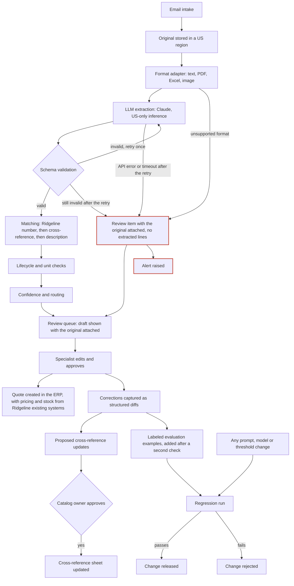

# Ridgeline Quote Desk

## Repository

https://github.com/FernandoSanabriaFSL/ridgeline-quote-desk-fde-ai-ml

## How to Run

### Setup

```bash
python3 -m venv .venv
.venv/bin/pip install -r requirements.txt
cp .env.example .env
```

Open `.env` and add your own `ANTHROPIC_API_KEY`. The example file lists variable names only; `LLM_MODEL` and `LLM_INFERENCE_GEO` are optional and default to `claude-sonnet-5-5` and `us`. `.env` is gitignored and never printed or logged. Developed on Python 3.11.

### Run

```bash
.venv/bin/python -m ridgeline.run
.venv/bin/python evaluation/evaluate.py
.venv/bin/python check_submission.py
```

- **`python -m ridgeline.run`** runs everything end to end for the six RFQs in `data/rfqs/`: extraction, matching, one `outputs/<rfq>.json` and one `outputs/review/<rfq>.md` per RFQ, and a summary of lines, auto-accepted and to review.
- **`--refresh`** calls the model instead of using the cache. It needs your key, and each call is billed.
- **`--stage extract`, `--stage match` or `--stage catalog`** runs one stage. `extract` is extraction only (from the cache unless `--refresh`), `match` matches from the cache and never calls the model, and `catalog` prints the data-quality report on `products.csv` and the cross-reference.
- **`python evaluation/evaluate.py`** scores `outputs/` against the answer key, prints the report and writes `evaluation/results.json`.
- **`python check_submission.py`** checks the submission (it also writes a zip of the submission, which is gitignored).

### Reproducibility

`.cache/llm` is committed. Extraction is replayed from it, so a re-run reproduces `outputs/` and `evaluation/results.json` exactly, without an API key and without a model call. A cache entry is keyed on the model, the prompt version and the RFQ text, and it stores a hash of the prompt, so editing the prompt re-extracts instead of serving a stale result. If an entry is missing and there is no key, that RFQ becomes an `extraction_failed` review line and the run carries on.

`AS_OF_DATE` (`YYYY-MM-DD`) pins the date used to decide whether a cross-reference row was verified more than two years ago. It defaults to today, so set it to get the same confidences on a later day. The results in this README use 2026-11-25.

## Approach

### The pipeline in five steps

| Step | Module | What it does |
|---|---|---|
| 1. Read | `adapters.py` | Turns each file into plain text by file type alone: email and text as is, PDF page text plus tables, every visible spreadsheet row as `R<row>: cell \| cell`. Images and scanned PDFs are reported as unsupported. There are no per-customer templates. |
| 2. Extract | `extract.py` | One Claude call per RFQ returns structured lines. Code then validates them against the source text, retries once on a bad reply, and caches the result. |
| 3. Match | `match.py`, `units.py` | Plain code against `products.csv` and `cross_reference.csv`: an RL number, then an exact cross-reference lookup, then a description score. Then a lifecycle check and the unit rules. |
| 4. Route | `match.py` | Confidence and flags decide whether a line is auto-accepted or goes to a specialist. |
| 5. Write | `pipeline.py`, `report.py` | One validated JSON file and one readable draft per RFQ, then a summary. Nothing is sent to anyone. |

### The key decision: the model reads, Ridgeline's data decides

The model turns messy RFQs into structured lines. It never decides what Ridgeline part a line is. Two reasons:

- **The old RPA bot broke whenever a customer changed format.** Reading free text, tables and email threads is what a language model is for, and it needs no per-layout code.
- **A wrong part number on a quote is the costly error.** So part numbers and prices never come from the model. It sees only the RFQ text and the extraction instructions, never the catalog, the cross-reference or a price, and the prompt treats the RFQ as data, not instructions. Ridgeline part numbers come only from `products.csv` or `cross_reference.csv`. A part number the model copies from the RFQ (the customer's own, or an RL number the customer wrote) must be found in the customer's text. The check compares letters and digits only, ignoring case. A number that is not found is flagged, not used for matching, and the line goes to review.

### Extraction

The prompt is `ridgeline/prompts/extract_v2.md`. It tells the model to:

- write one line per requested item, in order, and copy greetings, signatures, delivery notes, deadlines and terms word for word into `non_item_rows`;
- copy `as_written` verbatim, and take a quantity only when it is explicitly the amount (a vague amount gives null and `quantity_missing`; a quantity is never inferred);
- keep the unit exactly as written, and the customer's part number exactly as written;
- write `item_description` in the customer's words, with obvious abbreviations expanded and no specs added;
- resolve "same as above" from the line above, but not a reference to something outside the RFQ ("same as last order"), which gets `needs_human_review`;
- in an email thread, read every message, let later messages override earlier ones, keep the original item line as `as_written`, and flag `amended_in_thread` with who changed what;
- keep anything it cannot interpret as an `unparseable` line, never drop it, and never mention a price.

Code then checks that `as_written`, a non-null quantity and each part number appear in the source text, and flags any that do not. A reply that fails validation is retried once with the error message; if it still fails, the RFQ becomes one review line with the reason. The batch never crashes and nothing is dropped.

### Matching

Each line tries these in order and records the step that matched:

1. **An RL number the customer wrote** that exists in `products.csv`: confidence 0.98.
2. **An exact cross-reference lookup** on the normalized customer part number (letters and digits only). Never fuzzy: a near-miss is a different part. It starts at 0.95 and loses points for what the sheet itself says.
3. **A description score**, only if steps 1 and 2 found nothing: IDF-weighted coverage of the request's words in each product's description and category, after normalizing abbreviations, sizes and part codes. A line with no good match is `not_carried` and stays unmatched.

A line flagged `needs_human_review` or `unparseable` is never matched by description; the reviewer gets the top candidates in the note. A customer part number that is not in the cross-reference, on a line with no description, is `unknown_part_number`.

**Why the cross-reference is treated as fallible.** The sheet is half-maintained, and this data shows it: one target product is discontinued, one competitor part number points to two different targets, and 9 of its 52 rows have never been verified. So every hit is checked. Two targets for one key means no pick and a `cross_reference_conflict` flag. A discontinued target is replaced by its active successor, with confidence capped at 0.75. A `close sub` or `pkg qty differs` note, any other note, and a verification date that is empty or more than two years old each cost confidence. If the line has a description, it is scored against the target as a cross-check.

### Confidence and routing

| Match | Confidence |
|---|---|
| RL number the customer wrote | 0.98 |
| Cross-reference hit | 0.95 minus the penalties above |
| Description match | 0.5 + 0.35 x score + 0.5 x min(margin over the runner-up, 0.3), capped at 0.92, so a description match never outranks a verified cross-reference |
| Inferred part code (`variant_inferred`) | capped at 0.65 |
| Close alternative (margin under 0.05) | capped at 0.70 |
| Discontinued product replaced | capped at 0.75 |

A line goes to review if it has no part number, if its confidence is below `REVIEW_THRESHOLD` (0.80), or if it carries any flag. Every flag is a reason for review; anything merely informational goes in the note.

### Units

Only Ridgeline units go out (EA, BX, CS, PK, PR, RL, FT). A written unit is normalized (for example "boxes" to BX), and a matched line is output in the product's catalog unit. A container word such as "pail" that appears in the product description converts 1 to 1. A quantity in pieces against a pack product ("box of 100") converts when it divides evenly (300 pieces become 3 BX, flagged `unit_converted`, with the arithmetic in the note). Anything else keeps the customer's quantity and unit and is flagged `unit_mismatch`. A null quantity is never changed.

**The pack rule.** When no unit is written and the product is a pack of N, a quantity below N means packs and is kept. A quantity of N or more that divides evenly by N means pieces and is converted, with `unit_converted`. A quantity of N or more that does not divide evenly keeps the customer's number and gets `unit_mismatch`. A pack quantity of N or more never goes out without a flag.

### What is stubbed, and what production would do

The handwritten photo (rfq_04) is a stub: one review line with the flag `stub`, no extracted data, and the original file path in the note. Images are the only thing that gets the `stub` flag; an unsupported file type gets `unsupported_format` and a failed one gets `extraction_failed`. Production would send photos through vision extraction with every resulting line reviewed, as described in the Production section below.

### Trade-offs

| Decision | Chosen | Alternative | Why | What it costs |
|---|---|---|---|---|
| Reading RFQs | An LLM with validators in code | Rule-based parsers per format | Formats vary (threads, PDF tables, spreadsheets, typos) and per-format parsers are what broke the RPA bot | Model cost and latency (3 to 11 s per call here), and fresh calls are not deterministic |
| Matching descriptions | IDF-weighted lexical scoring in plain code | Embeddings, or an LLM tie-break | Deterministic and explainable (scores and candidates are printed), and the model never sees the catalog or picks a part | It misses synonyms, and the abbreviation map is small and hand-kept, so unfamiliar wording ends as `not_carried` and goes to review |
| Review load vs error risk | Review any flagged line, or confidence under 0.80 | Auto-accept more of the lines | A wrong part on a quote costs far more than a 30-second check | 39.3% of processed lines are reviewed here; no threshold in the sweep produced an auto-accepted error, so the cost of being cautious is review time only |
| Model | claude-sonnet-5-5 | Claude Haiku 5.5, which is much cheaper (see Production for the estimate) | Extraction quality on threads, abbreviations and ambiguity is where errors start, and model cost is small next to specialist time | Higher model cost per RFQ. Haiku's accuracy on these RFQs is not measured; switch (`LLM_MODEL`) only after a regression run shows no rise in corrections |

The production plan for matching (see Production) is embedding retrieval with an LLM tie-break restricted to the retrieved catalog rows. That changes the rule that the model only extracts, so it needs a deliberate decision first.

### Limits

- **The photo is stubbed.** Nothing is read from it.
- **The model does not accept a temperature setting.** The code asks for temperature 0 and falls back when the API rejects it, so fresh calls can word notes differently from run to run (between two fresh runs, 10 of 28 lines differed only in note wording). The committed cache pins the outputs.
- **Eight matching branches are not exercised by the sample data:** a cross-reference conflict, a cross-reference target missing from `products.csv`, a discontinued product with no active replacement, an RL number the customer wrote that is not in the catalog, the `close sub` and `pkg qty differs` penalties, the description cross-check on a cross-reference hit, and the weak-match flag. They are implemented as specified and reviewed, not measured. The `unsupported_format` and `extraction_failed` review lines also never fire on this data; only the photo stub does.
- **The part-number source check is a substring match** on letters and digits with punctuation removed, so a very short number could pass by accident, and a number embedded in longer text or spread across words counts as found.
- **19 labeled lines** cannot support strong conclusions (see Evaluation).

### Provider and region

The only model call is to the Anthropic Claude API, with `claude-sonnet-5-5`. Every request sets `inference_geo` to `us` and never drops it; if the API rejects the value, the call fails rather than silently running elsewhere. The region each response reports is recorded per call in the cache and in `evaluation/run_stats.json`, and it was `us` on all five calls. (The SDK's `messages.parse()` has no keyword for `inference_geo`, so it is passed in `extra_body`.) The Production section describes alerting on any other value.

### Business framing

Specialists spend about 75 minutes on an RFQ today. At about 400 RFQs a week that is about 500 specialist hours a week (400 x 75 minutes = 30,000 minutes). This release turns each RFQ into a draft so a specialist reviews instead of re-typing. 3 of the 19 labeled lines go to review, and 11 of the 28 lines across all six RFQs (the photo stub excluded). Time per draft has not been measured; the Production section states the assumption and what a pilot would measure. A person approves every quote, and pricing, discounts and sending are out of scope.

## Evaluation

The evaluation scores the pipeline's own output files against the answer key. `python evaluation/evaluate.py` reads `outputs/*.json` and `data/answer_key/` (it is the only code that reads the key), prints a report and writes `evaluation/results.json`. It imports nothing from the pipeline except `REVIEW_THRESHOLD`, so the pipeline and the evaluation share one threshold.

### How the metrics are computed

The answer key covers rfq_01, rfq_02 and rfq_03, 19 lines in all. Lines are aligned by line number. A line missing from the output, or an extra one, counts as an error and is listed in `results.json`.

- **extraction_accuracy**: the share of answer-key lines whose aligned output line has the same quantity and the same unit (null equals null).
- **match_precision**: correct part numbers divided by the lines where we output a part number. A part number on a line the key expects to be null counts as wrong.
- **match_recall**: correct part numbers divided by the answer-key lines with a non-null expected part number.
- **Lines the key expects to be null** (not carried, needs review) are left out of the recall denominator. Returning null with `needs_review` true on them is reported as `expected_null_handled`. A part number returned for one of them is a precision error.

The additional metrics in `results.json` are computed the same way from the same alignment:

- **Fields**: quantity, unit and `as_written` accuracy (`as_written` matches if either normalized string contains the other), and the line count per RFQ.
- **Method and flags**: `match_method` accuracy on correctly matched lines, and flag recall for the key's flags. `discontinued_replaced` and `not_carried` must appear in the output flags exactly; `needs_human_review` counts as met when `needs_review` is true.
- **Review and auto-accept**: the review rate on the labeled lines and on all processed lines with the photo stub excluded, and auto-accept precision. A line is wrong if its part number (null counts), quantity or unit differs from the key.
- **Confidence and routing**: mean confidence of correct matches, of wrong matches and of matches carrying an ambiguity flag (`variant_inferred`, `close_alternative`, `weak_description_match`, `discontinued_replaced`) across all six RFQs, and routing violations, meaning lines with no part or a confidence below the threshold that have `needs_review` false. That count must be 0.
- **Threshold sweep and errors**: described below.

### Results

These are the values in `evaluation/results.json` at `REVIEW_THRESHOLD` 0.80, with cross-reference dates checked as of 2026-11-25 (`AS_OF_DATE`; set it to reproduce a run on a later day). Extraction is served from the committed cache, so the numbers reproduce without an API key.

| Metric | Value | Basis |
|---|---|---|
| extraction_accuracy | 1.0000 | 19 of 19 key lines with the right quantity and unit |
| match_precision | 1.0000 | 17 of 17 output part numbers correct |
| match_recall | 1.0000 | 17 of 17 expected part numbers found |
| expected_null_handled | 1.0000 | 2 of 2 (null part, `needs_review` true) |
| quantity, unit, `as_written` accuracy | 1.0000 each | 19 key lines; line counts match in all 3 RFQs |
| match_method accuracy on correct matches | 1.0000 | 17 of 17 |
| flag recall | 1.0000 | 3 of 3 (`discontinued_replaced`, `needs_human_review`, `not_carried`) |
| review rate, labeled lines | 0.1579 | 3 of 19 |
| review rate, all processed lines (stub excluded) | 0.3929 | 11 of 28 |
| auto-accept precision | 1.0000 | 16 lines auto-accepted, 0 wrong |
| mean confidence, correct matches | 0.9188 | 17 matches |
| mean confidence, wrong matches | none | there are no wrong matches |
| mean confidence, ambiguity-flagged matches | 0.7000 | 3 matches across all six RFQs |
| routing violations | 0 | no line without a part, or below 0.80, skips review |

### Threshold

`REVIEW_THRESHOLD` is 0.80. The sweep re-applies the pipeline's routing rule at each threshold: a line is auto-accepted if it has a part number, a confidence at or above the threshold and no flags. The last column shows how many ambiguity-flagged matches would pass if confidence alone decided.

| Threshold | Labeled lines auto-accepted | Auto-accepted errors | Review rate, all lines | Ambiguity-flagged lines passing on confidence alone |
|---|---|---|---|---|
| 0.50 | 16 | 0 | 39.3% | 3 |
| 0.55 | 16 | 0 | 39.3% | 3 |
| 0.60 | 16 | 0 | 39.3% | 3 |
| 0.65 | 16 | 0 | 39.3% | 3 |
| 0.70 | 16 | 0 | 39.3% | 2 |
| 0.75 | 16 | 0 | 39.3% | 1 |
| **0.80** | 16 | 0 | 39.3% | 0 |
| 0.85 | 16 | 0 | 39.3% | 0 |
| 0.90 | 15 | 0 | 42.9% | 0 |
| 0.95 | 5 | 0 | 82.1% | 0 |

Read as review load against auto-accept errors: the review rate stays at 39.3% from 0.50 to 0.85, then rises to 42.9% at 0.90 and 82.1% at 0.95, while auto-accepted errors are 0 at every threshold. Raising the threshold past 0.85 only adds review work. The reasons for 0.80:

- **It is the lowest value on the sweep at which confidence alone stops every ambiguous line.** The three ambiguity-flagged matches score 0.65 (`variant_inferred`), 0.70 (`close_alternative`) and 0.75 (`discontinued_replaced`). The flags already send them to review; the threshold is a second safety net behind the flags.
- **It adds no review load on this data.** The review rate at 0.80 is the same as at 0.50.
- **It leaves a margin below the weakest correct match.** The lowest correct unflagged match scores 0.89 (rfq_03 line 5, a cross-reference hit with a "check thickness" note and a 2022 verification date), 0.09 above the threshold.

Because no threshold produces an auto-accepted error on 19 labeled lines, the sweep cannot show what a different threshold would save in errors. 0.80 rests on the gap between the highest ambiguous score (0.75) and the lowest correct one (0.89), and it should be re-checked on a larger set (see "Growing the set").

### Error analysis

We missed no answer-key line. All 19 lines aligned, none was missing or extra, every expected part number was found, both expected-null lines went to review with no part, and all three flags the key asks for were present. The error list in `results.json` is empty.

The three closest calls are the labeled lines matched by description with the smallest margin over the runner-up. (Cross-reference and RL-number matches have no competing candidate.) All three were correct, and none came near the 0.05 margin that would cap confidence at 0.70 and send a line to review.

| Line | Request | Chosen (score) | Runner-up (score) | Margin |
|---|---|---|---|---|
| rfq_01 line 4 | 1/2-13 x 2 in grade 8 hex bolts | RL165435 (1.000) | RL118726, the same bolt at 3 in (0.860) | 0.140 |
| rfq_03 line 3 | 1/2 in brass ball valve, full port | RL172063 (1.000) | RL193447, the 316 stainless 1/2 in valve (0.826) | 0.174 |
| rfq_01 line 2 | A42 v-belts | RL112676 (1.000) | RL182397, the B42 belt (0.810) | 0.190 |

rfq_05 and rfq_06 have no answer key, so these judgment calls are not scored. They are where a specialist's judgment matters, and each one is flagged for review:

- **Amended lines kept in review (rfq_05 lines 1 and 2).** The forwarded reply changed the motor from 3 HP to 5 HP and the gaskets from 20 to 40, in prose. The matches themselves are clear (RL110322 at 1.000 against 0.838, RL118373 at 1.000 against 0.809, confidence 0.92), but `amended_in_thread` keeps both in review: a spec changed in a forwarded reply is worth a 30-second check, because misreading it means quoting the wrong motor.
- **The inferred 6205 variant (rfq_06 line 4).** "6205 sealed bearings" names the model number but no part code. RL104165 (6205-2RS) scores 1.000 against 0.743 for RL112280 (6205-ZZ), and "sealed" points to the 2RS version, but the code is inferred, so confidence is capped at 0.65 with `variant_inferred` and the alternative named in the note.
- **The gloves chosen by unit (rfq_06 line 2).** "nitrile gloves L - a few boxes" ties at 1.000 between cut-resistant gloves sold by the pair (RL131850) and disposable gloves sold by the box (RL153354). The written unit, boxes, matches the disposable gloves, so they are chosen. Confidence is 0.70 with `close_alternative`, and the quantity is missing.
- **The 300 bolts converted to 3 boxes (rfq_06 line 1).** The line gives 300 and no unit, against a product sold as a box of 100. Because 300 is at least the pack size and divides evenly, it becomes 3 BX, flagged `unit_converted` with the arithmetic in the note. The customer also wrote that they usually get boxes, so the reading is ambiguous and a specialist confirms it.

### Small sample

19 labeled lines (17 with an expected part number) cannot support strong conclusions. One wrong line would move precision, and recall, by about 6 points (1 in 17). The labeled set also covers one RFQ per format (email, PDF, spreadsheet) and no photo. Perfect scores here do not predict perfect scores in production.

### Growing the set

- **Source**: past RFQs paired with the specialist-approved final quotes in the quoting system. The approved lines are the labels.
- **Target**: 300 RFQs (about 2,000 lines), stratified by format, customer and competitor, with 50 RFQs frozen as a test set that is never used for tuning.
- **Cadence**: backfill in the first 2 weeks, with a specialist spot-checking 10% of the labels. Then add 20 reviewed RFQs a week from production, and re-check the threshold monthly.

## Production

### Production flow

Built and measured in this repo: the format adapter through the review draft. Production design only, not built: email intake, US storage, the review queue and reviewer UI, alerts, the ERP step and the feedback path. Images are review-only stubs until vision extraction lands. Nothing is sent to a customer; a specialist approves every quote.



### Failure handling and new formats

- **Nothing is dropped.** Every RFQ file ends as one output JSON and one review draft. An unreadable file, an API error after the one retry, or a schema failure becomes a single review line (flag `extraction_failed`, the reason in the note, the original attached). In the sample run, 5 of 6 RFQs extracted on the first attempt and the sixth, a handwritten photo, became one review line.
- **Adapters only turn files into text.** `.txt` and `.eml` are read as is, PDFs go through pdfplumber and spreadsheets through openpyxl, chosen by file suffix alone. There are no per-customer templates, so a new layout needs no new code. This is the lesson from the RPA bot.
- **Unknown formats are reviewed, not guessed.** An unsupported type gets `unsupported_format`; a scanned PDF with no text layer gets the same flag; a photo gets `stub`. Each carries the original file for the specialist.
- **Validators flag and never delete.** A line whose text, quantity or part number is not found in the source gets a flag and goes to review. The model never supplies a Ridgeline part number.
- **New file types are counted and alerted on.** Each extension is counted per day, and the first sighting of a new one alerts the owner. The weekly counts decide which adapter to build next (proposal, not measured).

### Monitoring and alerts

- **Safety metric:** correction rate on auto-accepted lines above 2%. This is the key one, because those lines reach a quote with the least scrutiny. No baseline exists yet; 2% is a target, not a measurement.
- **Extraction health:** failures above 5% of RFQs in a day; p95 latency above 60 seconds. Measured today: 0 failures in 5 model calls and a slowest call of 11.1 s, but 5 calls cannot show a p95.
- **Drift:** review rate above 60% in a week, or 15 points above last month; cross-reference miss rate up 10 points. Today 11 of 28 processed lines (39.3%, photo stub excluded) are in review.
- **Service level and spend:** any RFQ waiting more than 4 business hours from arrival to specialist approval; daily spend over budget.
- **Data residency:** any call whose reported `inference_geo` is not "us" pages immediately. The pipeline already records it per call, and all 5 sample calls reported "us".

### Cost and latency

- **Measured** (`evaluation/run_stats.json`, 5 RFQs that reached the model; the photo was never sent): mean 3,268 input and 897 output tokens per RFQ; mean 5.7 s per call, median 4.7 s, slowest 11.1 s (the 8-line spreadsheet). Every call succeeded on attempt 1.
- **Per RFQ on Claude Sonnet 5.5:** (3,268 × $2 + 897 × $10) ÷ 1,000,000 = $0.0155, times 1.1 for US-only inference = **$0.017**, under 2 cents.
- **At 400 RFQs a week:** $6.82 a week and about $355 a year (52 weeks, 20,800 RFQs). Today's process is about 75 specialist minutes per RFQ, which is 30,000 minutes or 500 hours a week. Assumption, to be measured in a pilot: a specialist needs about 10 to 15 minutes to review a draft. That saves about 60 minutes per RFQ, roughly 400 hours a week at 400 RFQs. Review time per draft is not measured yet.
- **Claude Haiku 5.5 is the cheaper option** at $0.10 and $0.50 per million tokens: about $0.0009 per RFQ, $0.34 a week and $18 a year, roughly 20 times less. Its accuracy and latency on these RFQs are not measured. Switch only if a regression run shows no rise in the correction rate.
- **Assumptions:** the 5-RFQ mean holds at volume (the sample has only 3 to 8 lines per RFQ, and longer RFQs cost more because output grows with line count); no prompt caching or batching; one attempt per RFQ; same token counts on Haiku; the 1.1x US-only multiplier applies to every token; inference only, with hosting, storage, ERP and alerting excluded. Matching and the review draft are plain code with no model cost.

### Feedback loop with safeguards

- **Corrections are captured as structured diffs:** line, field, before, after, reviewer and time, with the original attached.
- **A corrected competitor part becomes a proposed cross-reference row,** trusted only after two independent confirmations or the catalog owner's approval. It never silently overwrites a row; a second target for the same key already raises `cross_reference_conflict`. The sheet needs this: 9 of its 52 rows have never been verified.
- **Corrected lines join the evaluation set only after a second check** by another reviewer or the catalog owner.
- **No change ships without a regression run.** Any prompt, model or threshold change must pass it first. The review threshold (0.80 today) is re-checked monthly against the correction rate by confidence band.

### Two more weeks

- **Vision extraction for photos,** with every photo line sent to review.
- **Live ERP data and intake:** catalog, stock and product status read live from the ERP instead of the CSV files, and email intake integrated.
- **Better matching:** embedding retrieval, then an LLM tie-break restricted to the retrieved candidates, and synonyms learned from corrections. The model would only choose among catalog rows and never write a part number. That departs from the current rule that the model only extracts, so it needs a deliberate decision first.
- **A reviewer UI** with the source and the draft side by side.
- **Backfill 300 labeled RFQs** as the regression set, up from the 6 sample RFQs in this repo.

### US data and secrets

- **US-only inference on every call:** `inference_geo` is set to "us" on each Claude API request and is never dropped. It is checked per call from the response, and a mismatch pages (see monitoring). A US workspace keeps data at rest in the US.
- **Originals, outputs and the extraction cache** live in a US bucket with a retention policy.
- **Keys live in `.env` locally,** which is gitignored. `.env.example` lists variable names only, with no values. In production they live in a secrets manager, rotated, and never logged; the code already replaces the key with `***` in any error text.
- **The model sees only the RFQ text and the extraction instructions.** It never sees the catalog, the cross-reference or any price, and the prompt treats the RFQ as untrusted data, not instructions.
